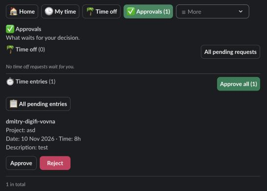

Managers, HR and admins approve or reject the time entries people submit. Nobody approves their own entries.

## What waits for whom

A submitted entry waits for the approvers of the team it was logged in (the owner's team at the time):

1. The people the team lists under **Team approvers**, if at least one of them is active, has the Manager, HR or Admin role, and isn't the owner.
2. Otherwise everyone with the HR role. This covers the entries of people in no team, of a team with no managers, and of the team's only manager.
3. Otherwise, when nobody has the HR role, every admin.

The owner is always left out. HR and admins may still decide anyone's entries; see [All pending entries](#all-pending-entries) below.

Team approvers are set up in [Teams and company rules](/logbook/docs/admins/teams-and-company-rules/). Submitting is described in [Submit time](/logbook/docs/everyone/submit-time/).

## The message you get

When someone submits entries that wait for you, Logbook sends you a DM: who submitted how many entries, the hours, and the projects with the most time, and that they wait for you under **Approvals**. You get one message per person each time they submit.

## The Approvals screen

**Approvals** in the navigation row counts what waits for you, time off and time entries together: **Approvals (5)**. Home also says **Needs your attention** with an **Open Approvals** button.

Under **Time entries** you see the entries waiting for you, ten to a page, newest work first. Each shows the person, the project and client, the date, the time and the description, with **Approve** and **Reject**.

### Approve or reject one entry

- **Approve** approves the entry at once, and it leaves the list. If someone else decided it first, it just leaves the list.
- **Reject** opens **Reject Time Entry** with an optional **Reason**. Click **Reject**. The screen says the owner gets a message.

The owner's DM names the entry, who rejected it and why, and the week to fix it in. They fix it and submit it again.

### Approve all

1. Click **Approve all (N)** next to **Time entries**.
2. **Approve Time Entries** says how many entries will be approved.
3. Click **Approve Time Entries**.

This approves every entry that waits for you, not only the page you see. The screen then says how many were approved.

:::note
**Approve all** covers what waits for you only. HR and admins don't approve everyone's time with it.
:::

## All pending entries

HR and admins can decide an entry when its approver is away.

1. Open **Approvals**.
2. Click **All pending entries**. The list shows every submitted entry in the workspace except your own.
3. Click **Approve** or **Reject** on an entry.
4. Click **Waiting for you** to go back.

**All pending entries** has no **Approve all**: you decide each entry yourself.

## After a decision

- An approved entry is locked for its owner. It counts as approved in reports.
- A rejected entry can be changed again by its owner, and becomes a draft once they change it. They submit it again for approval.

See [Notifications](/logbook/docs/reference/notifications/) for every message Logbook sends about time.
