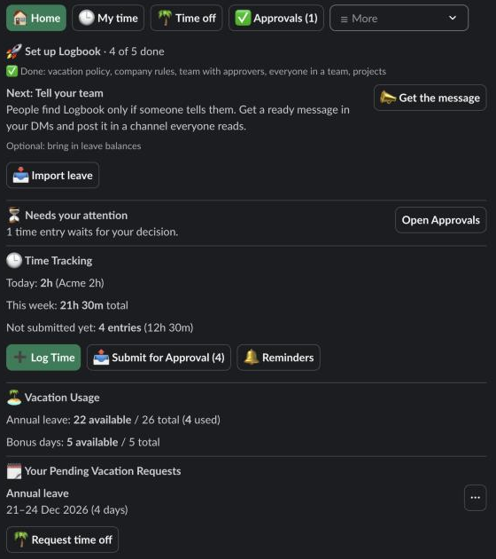

The **Home** tab of the Logbook app is where you start. Open Logbook under **Apps** in the Slack sidebar and choose **Home**.

## Move around

One row of buttons at the top of every screen moves you between the main screens:

**🏠 Home**, **🕒 My time**, **🌴 Time off**, **✅ Approvals** and **☰ More**.

- The button of the screen you are on is highlighted.
- **✅ Approvals** is for managers, HR and admins. It shows a count, such as "Approvals (3)", when requests or time entries wait for your decision.
- **☰ More** opens a menu with the rest of what your role may open. Under **Manage** you find **👥 People** and **📊 Reports**, and **🧾 Receipts** for Admin and Finance. Under **Settings** you find **🏢 Teams**, **📜 Policies**, **📁 Projects** and **💼 Clients**. Members only have **📊 Reports**, so it shows as a button instead of a menu. Roles with more screens see the menu, which shows the screen you opened from it.
- In a workspace with no project yet, nobody logs time, so the row leaves out **🕒 My time** and **📊 Reports**. They appear once an admin adds a project. `/log` still opens the **Log Time** form.
- A screen opened from another one has **⬅️ Back to** … under the row, for example **⬅️ Back to 🌴 Time off** on **📋 All requests**.

You can't open a screen your role doesn't allow. If you try, Logbook takes you to Home.

## Notices

When you save or send a form, it closes and the screen you were on shows a one-line notice under the button row. For example:

- "✅ Vacation request created."
- "✅ Vacation request canceled."
- "✅ Saved as a draft: 2h on Website."
- "✅ 3 time entries (6h) sent for approval."

If something is wrong, the form stays open and shows the error next to the field.

## What Home shows

Home shows only what has something to say, from top to bottom:

- **🚀 Set up Logbook** (admins and HR, until setup is done). See [Set up your workspace](/logbook/docs/getting-started/set-up-your-workspace/).
- **⏳ Needs your attention** (people who approve). Says how many time off requests and time entries wait for your decision, with an **Open Approvals** button.
- **🕒 Time Tracking**, once the workspace has a project. "Today" with the hours logged and the clients they were on, "This week" with the total, and, when you have drafts or rejected entries, "Not submitted yet" with their count and hours. Before you log anything in a week it says "Nothing logged this week yet." Buttons: **➕ Log Time**, **📤 Submit for Approval (N)** when something is waiting to be submitted, and **🔔 Reminders**, where you choose how often Logbook reminds you of unsubmitted time. To see or change your entries, open **🕒 My time** in the navigation row. See [Log time](/logbook/docs/everyone/log-time/) and [Submit time for approval](/logbook/docs/everyone/submit-time/).
- **🏝 Vacation Usage.** Your annual leave as "N available / M total", with what you used, working days and carryover. Bonus days appear when you have some. Sick leave, unpaid leave and Other appear once you have used any. With no vacation policy for you, it says "no limit" and shows only what you took. Until you take any, it is one line under **🏝 Time off**: no policy applies to you yet, and time off is tracked without a balance.
- **🗓 Your Pending Vacation Requests.** Each pending request has a menu: **📋 View Details** and **❌ Cancel**.
- **🧾 Receipts** (when your company collects receipts for a reimbursement). What you sent for each one this month and when it is due, with a **My receipts** button, and **🔔 Reminders** when you have no **🕒 Time Tracking** part to find it in. See [Send receipts](/logbook/docs/everyone/receipts/).
- **🌴 Request time off**, which opens the request form. See [Request time off](/logbook/docs/everyone/request-time-off/).
