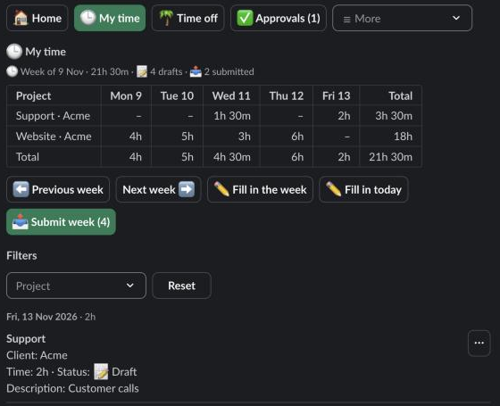
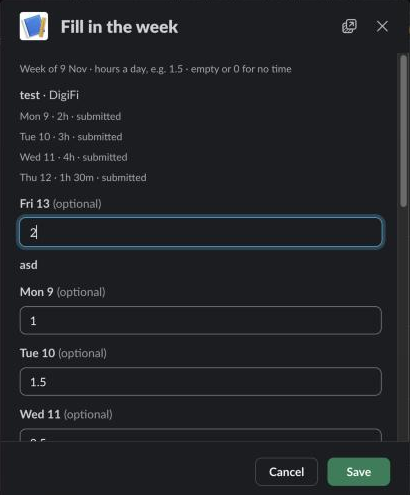

Use Logbook to record the hours you work on projects. Time you log is a draft until you submit it. See [Submit time for approval](/logbook/docs/everyone/submit-time/).

## Log one entry

1. Open the **Log Time** form: click **➕ Log Time** on **Home**, or type `/log`. On **🕒 My time**, fill in the week or a day instead (see below).
2. Choose the **Project**. If you have only one, it is already chosen.
3. Choose the **Date**. It starts on today.
4. Enter the **Hours**, for example 1.5.
5. Add a **Comment** if you like. It is optional.
6. Click **Save**.

The form closes and you see a notice such as "✅ Saved as a draft: 2h on Website. Submit it from Home when your time is complete."

If you have no projects, the form says so. Ask an admin to add you or your team to a project.

## The week on My time

**🕒 My time** opens on the current week. A line above the table says "Week of …" with the total and how many entries are drafts, submitted, approved or rejected. The table has one row per project with your hours for each day, and a total row. Saturday and Sunday show only when they hold time. A dash means no time.

Use **⬅️ Previous week** and **Next week ➡️** to move between weeks. Below the table, your entries are listed by day with each day's total. Filter them by project. Each entry has a menu with **Edit**, **Submit** and **Delete**.

## Fill in the week or the day

Use these forms to enter many hours at once instead of one entry at a time.

- **✏️ Fill in the week** opens **Fill in the week**. It is the highlighted button until the week has something to submit.
- **✏️ Fill in today** opens **Fill in the day**, one day with a **Comment** field and a **Day** picker.

Each project has a row, and each day has one input. Enter hours a day, for example 1.5. Leave a cell empty or type 0 for no time. Click **Save** when done.

- **Rows.** You get the projects you logged time on in this week or the four before, and projects you add. Choose **Add a project** to add another, up to 10 rows in all.
- **Weekend.** Saturday and Sunday are hidden unless they hold time. Tick **Show Saturday and Sunday** to see them.
- **Submit the week.** On the week form, tick **Submit the week's time for approval** to submit as you save.
- **Comment.** On the day form, the **Comment** goes on every entry you create or change. Leave it empty to keep the descriptions as they are.
- **Read-only cells.** A cell is plain text, not an input, when you can't change it here. Its label says why: the day has several entries ("2 entries", change them on **My time**), or it is "submitted", "approved" or "billed", or the project is "closed for logging". A cell can be changed when it is empty or holds one draft or rejected entry.
- **Changed elsewhere.** If an entry changed after you opened the form, a cell you touch is refused with "This time changed after the form opened: open the form again." Cells you leave as they were are skipped. A hint under a cell says what it holds now.

After saving, **My time** shows the week, or the day's week, with a notice such as "✅ Saved. Week of …: 32h." A rejected entry you change becomes a draft again.

## Limits

- Hours go in 15-minute steps: 0.25 is 15 minutes, 1.5 is 1 hour 30 minutes.
- At most 24 hours a day for one person on one project.
- You can change only drafts and rejected entries. Submitted and approved entries are locked, and so is any time in a billing snapshot.

## Which projects you can log on

You can log on the projects assigned to your team or to you. Admins and HR can log on any active project, and can log for other people from **⏱ Time logs**.

## Drafts

An entry starts as a draft, and only you see it. Home counts them under **Not submitted yet**. Drafts don't reach approvers until you submit them.
