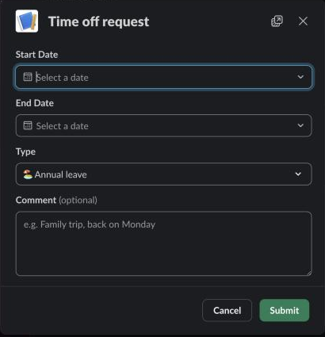

Use this page to ask for time off, to understand who decides it, and to cancel a request that is still waiting.

## Leave types

| Type | Counts against |
| --- | --- |
| 🏖️ Annual leave | Your annual leave balance. |
| 🎁 Bonus day | Your bonus days balance. |
| 🤒 Sick leave | Nothing. Only tracked. |
| 💸 Unpaid leave | Nothing. Only tracked. |
| 📌 Other | Nothing. Only tracked. A comment is required. |

## Request time off

1. Start the form in one of three ways:
   - On **Home**, click **🌴 Request time off**.
   - On **🌴 Time off**, click **➕ Request time off**.
   - In any Slack conversation, type `/vacations request`.
2. Choose the **Start Date** and **End Date**.
3. Pick a **Type**. It starts on **Annual leave**.
4. Add a **Comment**. It is optional, except for the type **Other**, where it is required.
5. Submit the form.

The form closes and Home, or **Time off** if you started there, shows "✅ Vacation request created." Your request is pending.

## What counts against your balance

- Pending and approved requests count. Rejected and canceled ones don't.
- Annual leave counts calendar days and working days. Both must fit your balance. Bonus days count working days only. Weekends and your policy's holidays are not working days.
- If you request more than you have, the form says "Not enough vacation days" (or "working" or "bonus" days) under the end date, with what you asked for and what is available.
- Two pending or approved requests can't cover the same day.
- You get your balance from the vacation policy of your team, or of the company rules. With no policy, Logbook only tracks what you take and checks no balance. Home shows "no limit".

Type `/vacations usage` to see your days used and left. Only you see the answer.

## Who gets it

Your team's approvers decide in levels:

- First your team's approvers, then, if your company has one, a second approval by HR. A level can need one approver ("any") or all of them.
- Nobody approves their own request. If you are the only approver of your team, it goes to the next option.
- If nobody on your team can approve, the request goes to everyone with the HR role. If nobody has it, it goes to the admins.
- If there is nobody who could approve at all, the request stays pending. Once an admin names approvers for your team or in the company rules, or gives someone the HR or Admin role, it goes to them as a new request would, and you get the message saying where it went.

## The messages you get

Logbook writes to you in a direct message:

- **Where it went.** "📨 Your vacation request (dates) went to … (Manager approval)." When it went to HR or the admins instead, it says why. When nobody can approve yet, you get a "⚠️ Nobody can approve your vacation request" message that says what an admin has to do, and the "📨" message once someone can.
- **Others off.** "⚠️ Also off on those days: …" lists teammates with time off on the same days, so you know it may be rejected.
- **Each level approved.** After a level that isn't the last: "✅ Your vacation request (dates): Manager approval done by …. Now waiting for HR approval from …."
- **Comments.** When an approver comments: "💬 … commented on your vacation request". The message has **📋 View Details** and **❌ Cancel Request**. The request stays pending. To change its dates, cancel it and request new ones.
- **The decision.** "✅ Your time off request was approved" or "❌ Your time off request was rejected", with the reason, comments and who decided. You get it too when HR or an admin approves or rejects your request with **Edit Request**, even after it was decided, but not after you canceled it. It then names them as who decided. After an approval the message may have a button to log the days as hours: see [Time off as time](/logbook/docs/everyone/time-off-as-time/).

## Cancel a pending request

Only a pending request can be canceled.

- On **Home**, open the menu of the request under **🗓 Your Pending Vacation Requests** and choose **❌ Cancel**.
- Or type `/vacations cancel`, pick the request in **Cancel Vacation**, and click **Cancel Request**.
- Or click **❌ Cancel Request** in a message about it.

You see "✅ Vacation request canceled." and the approvers' messages are closed.

## Follow your requests

**🌴 Time off** lists your requests with their type, dates, days, status and any rejection reason. Filter by type, year and status, and open **View Details** in a request's menu.

Managers, HR and admins also see **🟢 Who's off next** at the top: who in their teams has approved time off ahead. **📋 All requests** opens everyone's requests they may see.
