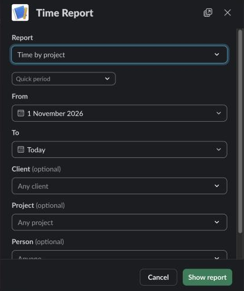
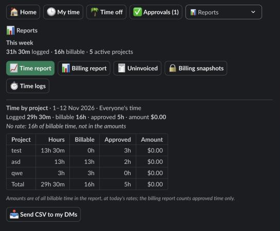

Reports is open to every role. Open it from the navigation row, under **☰ More** for roles that have a menu. It shows the week at a glance, the time report, and for some roles more.

## What you see

Everyone sees a report of their own scope. It is set by your role, not by the form.

| Role | Time in your reports |
| --- | --- |
| Admin, HR, Finance | Everyone's time |
| Manager | Your teams' time and yours |
| Member, or a manager of no team | Your time |

A line above the table says which scope it is: **Everyone's time**, **Your teams' time and yours** or **Your time**.

Amounts appear only for Admin and Finance.

## The week on Reports

**This week** at the top shows how many hours were logged this week and how many were billable. Roles that manage projects also see the number of active projects. It follows the same scope as reports.

## Show a time report

1. On Reports, choose **📈 Time report**.
2. In **Report**, choose **Time by client**, **Time by project**, **Time by person** or **Time by team**. The default is project.
3. Pick a **Quick period** (this or last week, month or quarter) to fill the dates, or set **From** and **To** yourself. The default is this month up to today.
4. Optionally filter by **Client**, **Project** and **Person**.
5. Choose **Show report**.

The period can be a year at most (366 days). Members filter by project only. Clients and people appear in the filters only for roles that see other people's time, and the person filter lists the people in your scope.

The report counts every entry in the period except deleted ones: drafts, submitted, approved and rejected. The table has one row per client, project, person or team, and a total row:

| Column | Meaning |
| --- | --- |
| Hours | All time logged |
| Billable | Time on billable projects |
| Approved | Time that has been approved |
| Amount | Admin and Finance only: all billable time at today's rates |

Billable time with no rate isn't in the amounts. A line says how much it is. Long reports are cut to fit Slack and say how many lines are left, which are still in the total.

## Who hasn't submitted

Managers, HR, Admin and Finance can choose **Who hasn't submitted** in **Report**. It lists the active people in your scope who:

- logged nothing in the period, or
- still have drafts or rejected entries in it that weren't sent for approval.

The table shows **Person**, **Team**, **Logged** and **Not submitted**. The client, project and person filters don't apply to it.

## Send CSV to my DMs

Below a time report, choose **📥 Send CSV to my DMs** to get its entries as a file in a DM from Logbook.

The file has one line per entry of the report on show, with the same scope and filters. Columns: Date, Person, Email, Team, Client, Project, Description, Hours, Billable and Status. Admin and Finance also get Rate, Amount and Currency. The file opens in a spreadsheet.

- A file holds at most 200,000 entries. For more, the DM asks you to show a shorter period or narrow the report.
- With no entries, the DM says there is nothing to export.
- The export needs the files:write permission. If your workspace installed Logbook before this permission existed, the DM says so. Ask whoever installed Logbook to install it again. Nothing is lost.
- Only one export of the same report runs at a time. Choosing the button again says the CSV is already on its way.
- If Slack fails, Logbook retries for several hours. If it still can't send the file, it sends a DM that says it couldn't, and you can show the report and send the CSV again.

Reports shows **📨 Sending the CSV to your DMs.** right after you choose the button.

## Time logs

Admin and HR have **⏱ Time logs** on Reports. It lists everyone's entries, which they can edit, with From and To filters. Entries in a billing snapshot show as billed and can't be edited or deleted. Everyone else sees and edits their own entries on **My time**; see [Log time](/logbook/docs/everyone/log-time/).

## Related

- [Billing](/logbook/docs/finance/billing/)
- [Submit time for approval](/logbook/docs/everyone/submit-time/)
- [Approve time](/logbook/docs/approvers/approve-time/)
